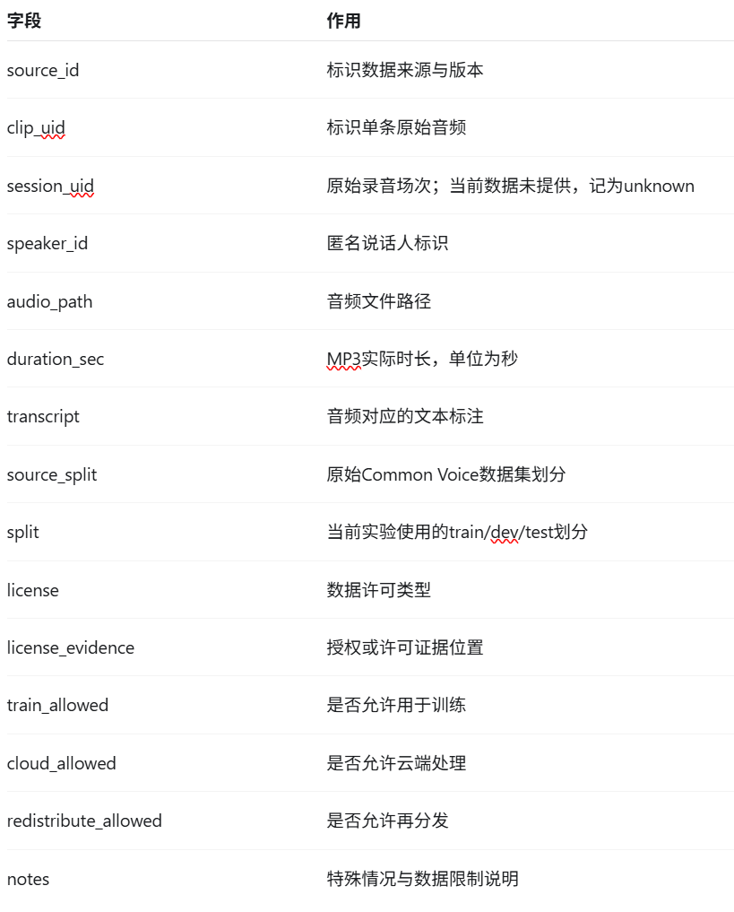

# W4D3 模块1：数据来源与许可

## 1. 为什么需要数据登记

原因：

>语音算法项目不仅需要音频文件本身，还需要确认数据是否具有训练和处理权限

因此需要记录：

- 数据来源；
- 授权范围；
- 使用限制。

如果没有登记可能导致：

- 使用未经授权的数据；
- 无法确认是否允许训练；
- 无法复现实验

---

## 2. 数据源信息

一个可训练数据集需要记录：

来源：

>数据来自哪里，例如公开数据集、自录数据等。

原始场次UID：

>表示原始录音session编号，用于追踪音频来源

授权证据：

>记录数据使用许可或说话人授权信息。

允许训练：

>说明是否允许用于模型训练

允许云端处理：

>说明是否允许上传服务器或云平台进行处理。

允许再分发：

>说明是否允许将数据再次发布。

---

## 3. 为什么需要原始场次UID

作用：

>用于追踪原始录音来源，并保证train/dev/test按照独立session划分。

避免：

>随机切割导致同一录音session同时进入训练集和测试机，使模型利用说话人、环境等信息，造成测试结果虚高。

---

## 4. 数据划分

train:

>训练模型，用于：更新参数、学习语音模式

dev:

>开发验证集，用于：调参数、比较模型、选择checkpoint

test:

>最终测试，特点：不能参与：调参、模型选择

注意：

>应按照session划分，而不是随机切割音频片段

---

## 5. 数据不足时处理

如果没有足够公开授权数据：

>可以使用经过本人同意的自录数据

需要记录：

- 录音条件
- 说话人数
- 环境
- 偏执

例如：
speaker:
单一男性

environment:
安静室内

device:
手机麦克风

bias:
缺少女性和噪声环境

---

## 核心结论

>语音数据不仅是wav文件，而是包含来源、授权、划分方式和分布信息的数据资产，合理的数据登记和划分方式，是保证ASR实验可靠性和可复现性的基础。

# W4D3 模块2：source_registry设计与数据登记

## 1. source_registry.csv作用

作用：

>语音数据的元数据管理表

它解决的问题：

>仅有音频文件无法判断数据是否允许训练、能否上传云端处理，也难以保证数据集划分的可靠性。登记表为后续数据筛选、实验复现、权限检查和训练数据构建提供依据。

---

## 2. 字段设计

source_id：

>数据来源编号，例如SRC001。同一来源可以包含多个录音场次。

session_uid：

>原始录音场次唯一编号。例如session001，属于同一场录音的多个音频片段应该保留相同的session_uid。

speaker_id：

>说话人编号，用于识别音频所属说话人，分析说话人覆盖范围，以及检查不同数据集之间是否存在说话人重叠。

audio_path：

>音频文件路径

duration：

>记录音频时长

license：

>记录数据授权来源

train_allowed：

>是否允许用于模型训练

cloud_allowed：

>是否允许上传云端处理

redistribute_allowed：

>是否允许再次分发数据

split：

>数据属于哪个集合，通常为train、dev、test。

---

## 3. 为什么session_uid重要

原因：

>一个原始录音session可能被切割成多个音频文件，这些文件共享说话人、设备、录音环境等信息。如果随即划分到不同数据集，可能引入数据泄露，使测试结果偏高。

数据划分依据：

>优先按照原始session划分，保证同一session的所有片段只属于同一个split

补充：

session互斥并不意味着speaker互斥。如果需要评价模型对未知说话人的泛化能力，还应检查speaker_id，进一步使用说话人互斥划分。

---

## 4. train/dev/test划分

划分原则：

>session级划分

示例：

train:

>session001、session002、session003、session004

dev:

>session005

test:

>session006

---

## 5. 数据登记示例

一条记录：

{
 "audio": "001.wav",
 "text": "hello world",
 "speaker": "spk01",
 "session": "session001"
}

---

## 核心结论

>source_reqistry.csv用于管理语音数据的来源、录音场次、授权范围和数据集划分，是语音工程中重要的元数据文件。
>session_uid用于追踪原始录音，帮助避免同一场录音被同时划分到train/dev/test/train_allowed、cloud_allowed和redistribute_allowed分别控制训练、云端处理及再分发权限，不能相互替代。
>在开展ASR训练之前，应先确认授权，再按独立录音场次完成合理划分。只有具备清晰来源、合法使用权限和可靠划分方式的数据，才能支持可追溯、可复现的语音实验。

# W4D3 模块3：source_registry实践

## 1. 文件结构

项目目录：

speech-ai-learning/
├── data/
│   └── raw/
│       └── common_voice_beijing26/
├── metadata/
│   └── source_registry.csv
└── src/
    ├── inspect_commonvoice.py
    └── build_source_registry.py

source_registry位置：

>metadata/soource_registry.csv

该文件记录筛选后的音频及其来源、许可、说话人、时长和数据集划分信息。原始MP3仍保存在data目录中，不需要重复复制。

---

## 2. CSV字段

最终字段：

>source_id, clip_uid, session_uid, speaker_id, audio_path, duration_sec, transcript, source_split, split, license, license_evidence, train_allowed, cloud_allowed, redistribute_allowed, notes

每个字段作用：

>

---

## 3. 数据候选登记

候选数量：

- 已筛选437条音频
- 包含118个不同的匿名说话人ID
- 原始独立录音场次数量未知

数据来源：

>Mozilla Common Voice Scripted Speech 26.0 — Beijing Chinese。从原始TSV和MP3构建本地数据清单，保留中文转写文本及匿名说话人标识

总时长：

>38.10min

---

## 4. 数据授权检查

检查内容：

- 数据来源是否可追溯。
- 数据许可是否覆盖模型训练用途。
- 是否允许云端处理。
- 是否允许再次分发。
- 是否保留了授权证据和必要的限制说明。

授权状态：

- 数据集页面标注许可：CC0-1.0。
- license_evidence：官方数据集页面URL。
- train_allowed：脚本暂记true，依据数据集许可信息。
- cloud_allowed：pending_review。
- redistribute_allowed：pending_review。

---

## 5. train/dev/test规划

划分依据：

>按照speaker_id进行说话人互斥拆分，保留Common Voice原始split，并检查跨集合重叠。

train：

- 288条音频。
- 27个说话人ID。
- 1503.660秒（25.06分钟）。

dev：

- 91条音频。
- 33个说话人ID。
- 481.080秒（8.02分钟）。

test：

- 58条音频。
- 58个说话人ID。
- 301.128秒（5.02分钟）。

---

## 6. 当前数据不足或偏置

存在问题：

- Common Voice未提供可靠的原始session_uid，无法核实六个独立录音场次。
- 数据仅覆盖当前选择的北京中文子集及少量样本，不能代表完整中文语音分布。
- Train/dev/test的数据量和说话人数量不均衡。
- Test中每个说话人目前只有一条音频，评估稳定性有限。
- 尚未完成云端处理、再分发权限的最终核验。

后续改进：

- 结合具体实验目标，补充录音场次明确的授权数据，或采用经同意的独立自录。
- 在正式ASR训练前检查转写质量、音频质量和录音条件。
- 根据模型评估需要扩大测试样本，并分析不同说话人及环境下的性能。
- 保存许可版本、授权证据和数据构建脚本，保证实验可追溯。

---

## 核心结论

>本次实验成功从Common Voice数据集中筛选出437条音频，总计38.10分钟，包含118个不同的匿名说话人ID，且train/dev/test没有说话人交叉。
>通过Python自动读取TSV、检查MP3路径、计算实际时长并生成source_registry.csv，建立了最小可用的数据登记流程。
>需要注意，数据文件可用不等于所有授权均已确认；说话人互斥也不等于原始录音场次互斥。实际语音工程中，应同时关注数据可追溯性、使用权限和实验评估的可靠性。

## W4D3：数据来源与许可

### 1. 本日任务与产出

**数据来源与版本：**

> Mozilla Common Voice Scripted Speech 26.0 — Beijing Chinese（zh-CN），通过 Mozilla Data Collective 获取。

**完成的工作：**

- 下载并解压 Common Voice 中文数据。
- 使用 pandas 读取 train.tsv、dev.tsv 和 test.tsv，检查数据字段及匿名说话人 ID。
- 使用 Python 筛选所需音频，读取 MP3 实际时长。
- 检查 train/dev/test 之间是否存在说话人交叉。
- 自动生成数据来源登记表 source_registry.csv。

**代码与产出路径：**

- src/inspect_commonvoice.py：检查 TSV 内容与字段。
- src/build_source_registry.py：筛选音频并生成登记表。
- data/raw/common_voice_beijing26/：原始音频与元数据。
- metadata/source_registry.csv：筛选后的数据来源登记表。

### 2. 数据筛选与划分结果

**总音频条数：**

> 437

**总时长：**

> 38.10分钟

**独立说话人 ID 数：**

> 118

| 数据集 | 音频条数 | 说话人 ID 数 | 时长（分钟） |
|---|---:|---:|---:|
| Train |288|27|25.06|
| Dev |91|33|8.02|
| Test |58|58|5.02|

**数据泄漏检查结果：**

> 各数据集说话人重叠数均为0，且缺失MP3文件数为0

### 3. 数据许可与可追溯性

**已登记的授权信息：**

> 数据来源于 Mozilla Data Collective，数据集页面标注 CC0-1.0。登记表记录了来源、许可类型、许可证据页面、匿名说话人 ID 和音频路径。train_allowed 由构建脚本依据数据集许可标记为 true，仍需以实际适用条款为准。

**仍需核验的权限：**

- 云端处理权限：pending_review。
- 原始音频再分发权限：pending_review。
- 应保存实际下载时接受的许可及附加条款，确认后再更新字段。

**原始 session_uid 是否可确定：**

> 不可确定，Common Voice提供匿名说话人ID，但没有提供可核实的原始录音场次UID，因此当前统一记录为unknown。

### 4. 当前限制与问题

**已发现的数据限制或偏置：**

- 数据规模较小，主要用于验证音频数据处理流程。
- 使用北京中文子集，不能代表完整的中文语音分布。
- Train、Dev、Test 的说话人数量和音频时长不均衡。
- Test 集每个说话人 ID 仅抽取一条音频，评估稳定性有限。
- 原始录音场次及部分授权条件尚未核实。

**尚未达到的验收条件：**

- 无法证明已取得至少6个独立原始录音场次。
- 尚未完成云端处理和再分发权限的最终核验。

### 5. 下一步工作

- 核验并保存实际适用的许可条款，更新待审核的权限字段。
- 检查音频的采样率、声道和时长分布。
- 检查音频与转写文本的一致性，为后续 Dataset/DataLoader 做准备。
- 如需严格满足原始录音场次级验收，补充具有明确 session 信息的授权数据或经同意的独立自录，并记录偏置。

### 6. 实际投入时间

> 2h

### 7. 本日核心收获

本次学习掌握了语音数据来源登记的基本流程，包括数据获取、元数据检查、真实时长统计、使用权限登记以及按说话人划分数据。
理解了数据文件与元数据的区别，以及 speaker_id 和 session_uid 的不同作用。
认识到程序成功运行并不代表数据已经满足全部训练条件。可靠的语音工程不仅需要可读取的数据，还需要可追溯的来源、明确的授权和合理的数据划分。