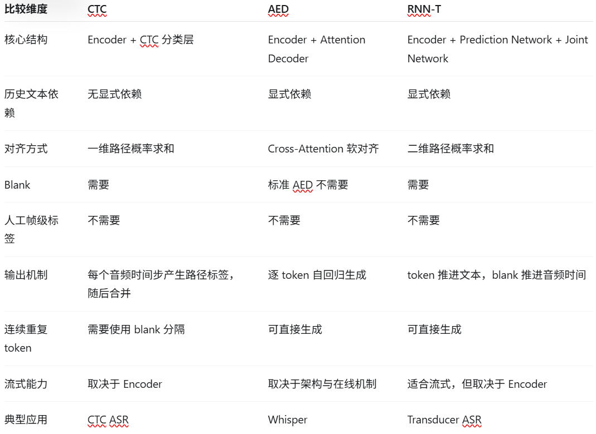

# W7D1 模块1：CTC

## 1. CTC 要解决的问题

ASR 的输入是什么：
一段语音信号，通常先转换为Waveform、Log-Mel等特征，再输入Encoder进行处理

ASR 的输出是什么：
对应的文本token序列，例如字符、子词等

为什么输入帧数通常多于输出 token 数：
语音是随时间连续变化的信号，一个字符通常对应多个音频时间帧。因此，音频的时间帧数通常远大于文本token数。

什么是输入与输出之间的对齐：
确定语音的哪些时间帧对应输出文本中的哪些token。例如，某个字可能对应第10~20帧的语音特征

为什么不希望人工提供帧级对齐标签：
帧级对齐的标注成本很高，而且不同语速、发音方式会导致同一token持续的帧数不同。CTC可以只利用整段语音对应的转写文本训练模型，无需人工提供每帧标签。

## 2. CTC 的模型结构

CTC 的主要计算流程：
$$
\text{Audio}\rightarrow\text{Features}\rightarrow\text{Encoder}\rightarrow\text{Linear+Softmax}\rightarrow\text{CTC Decode}\rightarrow\text{Text}
$$

Encoder 的作用：
从输入音频特征中提取高层表示、可以通过CNN、RNN或Transformer等结构获取语音的上下文信息

每个时间步输出什么：
输出一个token概率分布，包括普通文本token和特殊blank token

Blank token 的作用：
表示当前时间步不产生新的输出token，同时允许相邻的相同token通过blank分隔，避免被错误合并。

CTC 的输出序列如何转换为文本：
按照CTC合并规则，先合并连续重复的token，再删除blank，最终得到文本序列

## 3. CTC 的条件依赖

CTC 的条件独立假设：
给定输入语音X，CTC假设一条对齐路径上不同时间步的输出标签再概率建模上条件独立

CTC 路径概率公式：
$$
P(\pi\mid X)=\prod_{t=1}^{T}P(\pi_t\mid X)
$$
其中：
- X：输入语音。
- π：一条包含普通 token 和 blank 的对齐路径。
- T：Encoder 输出的时间步数。
- π_t：第 t 个时间步对应的标签。

CTC 最终序列概率公式：
$$
P(Y\mid X)=\sum_{\pi\in B^{-1}(Y)}P(\pi\mid X)
$$
代入路径概率后：
$$
P(Y\mid X)=\sum_{\pi\in B^{-1}(Y)}\prod_{t=1}^{T}P(\pi_t\mid X)
$$
其中，B 表示 CTC 合并函数，B⁻¹(Y) 表示所有经过合并能够得到目标文本 Y 的合法路径集合。

为什么需要对多条对齐路径求和：
因为同一个文本可能对应多条不同的帧级对齐路径。例如，“你好”可能对应“你、你、blank、好”，也可能对应“blank、你、好、好”。由于没有人工指定真实的帧级对齐，CTC 需要汇总所有合法路径的概率。

CTC 是否需要显式帧级监督：
不需要。训练时只需要输入音频及其对应的完整文本，CTC 通过对合法对齐路径求和，隐式学习输入与输出的对应关系。实际计算使用动态规划实现。

## 4. CTC、语言模型与流式识别

CTC 是否可以融合语言模型：
可以。CTC 可以在解码阶段融合外部语言模型，例如使用 Beam Search 和浅融合方法。
一种常见的打分形式：
$$
S(Y)=\log P_{\mathrm{CTC}}(Y\mid X)+\lambda\log P_{\mathrm{LM}}(Y)+\beta|Y|
$$
其中，λ 是语言模型权重，β 是可选的长度奖励权重。

语言模型在 CTC 中提供什么信息：
语言模型可以利用文本序列中的语言规律，为候选识别结果提供额外评分，辅助选择更合理的文本序列。

CTC 为什么不一定支持流式识别：
流式识别指在音频持续输入的过程中，模型能够逐步处理语音并输出识别结果，而不需要等待完整语音结束。
虽然CTC逐时间步输出概率，但如果Encoder需要完整的未来音频信息，模型仍无法直接进行严格流式识别。
因此CTC本身不保证流式能力。

Encoder 的右上下文如何影响流式能力：
右上下文指模型处理当前时间步时，需要使用多少未来时间步的信息。
- 因果 Encoder：不使用未来音频，适合流式处理。
- 有限右上下文 Encoder：只需要少量未来音频，可以通过增加一定延迟进行流式处理。
- 无限制双向 Encoder：可能依赖完整未来语音，无法直接保证严格流式处理。
右上下文越多，通常可能获得更多上下文信息，但也可能带来更高的等待延迟。

## 5. 实例与理解

路径一：[你, 你, blank, 好, 好] 的输出：
你好

路径二：[你, blank, 你] 的输出：
你你

CTC 为什么允许不同路径对应相同文本：
因为多个帧级路径经过 CTC 合并规则后，可以得到相同的文本。CTC 不要求某个 token 必须与固定的某一帧对齐。

CTC 条件独立假设的主要局限：
CTC 的输出路径概率没有显式建模历史输出 token 对当前 token 的条件依赖，因此直接利用已生成文本上下文的能力有限。
虽然 Encoder 可以通过音频上下文提取特征，也可以融合外部语言模型，但标准 CTC 本身没有自回归 Decoder 那样的历史 token 条件依赖。

## 6. 模块验收

Q1：为什么 CTC 不需要帧级监督？
CTC为输入语音的各个时间步输出token概率分布，并考虑所有能够合并为目标文本的对齐路径。
通过对这些路径的概率求和，可以计算目标文本的概率，因此不需要人工指定每一帧对应哪个token。

Q2：两条路径的合并结果是什么？
A：你 → 你 → blank → 好 → 好

输出：“你好”。

B：你 → blank → 你 → 好

输出：“你你好”。

因为 blank 分隔了两个“你”，所以不会合并。

Q3：使用双向 Transformer Encoder 的 CTC 模型是否一定支持严格流式识别？
不一定。
严格流式识别要求模型不依赖尚未到达的完整未来音频。但双向 Transformer 可能需要读取未来时间步的信息。因此，即便使用 CTC，也无法保证严格流式识别。
是否支持流式处理，主要取决于 Encoder 的上下文限制和实际推理方式。

Q4：为什么 Encoder 有 Self-Attention，CTC 仍然存在条件独立假设？
因为 Encoder 的上下文建模与 CTC 输出路径的概率分解属于不同层次。
Encoder 可以通过 Self-Attention 融合不同音频帧的信息，但标准 CTC 仍然将路径概率分解为各时间步标签条件概率的乘积，不显式依赖之前生成的 token。
因此，Encoder 能提取上下文，并不意味着 CTC 消除了条件独立假设。

# W7D1 模块2：Attention Encoder-Decoder

## 1. AED 要解决的问题

AED 的输入与输出：
AED（Attention Encoder-Decoder）将输入语音映射为输出文本序列。
输入通常是 Waveform 或 Log-Mel 等语音特征，经过 Encoder 提取高层音频表示后，由 Decoder 逐个生成文本 token。

AED 与 CTC 的核心区别：
CTC对每个音频时间步预测标签，通过对合法对齐路径求和计算文本概率。标准CTC的路径概率分解没有显式依赖历史输出token。

AED采用组回归Decoder，每次生成一个文本token，当前token的预测显式依赖输入语音和之前生成的文本。

AED 是否需要显式帧级对齐标签：
不需要。
AED 通过 Cross-Attention 学习文本与语音特征之间的软对齐，因此训练时只需要完整语音及其对应的转写文本。

什么是自回归生成：
自回归生成指当前输出依赖之前已经生成的输出。
例如生成“你好”：
- 第一步：根据起始 token 和音频信息预测“你”。
- 第二步：根据起始 token、已经生成的“你”和音频信息预测“好”。
- 第三步：根据之前生成的文本预测结束 token。
因此，推理时后一个 token 需要以前面生成的 token 为条件。

## 2. AED 模型结构

AED 的主要计算流程：
语音特征输入Audio Encoder，得到音频隐藏状态。Decoder接收历史文本token，通过Self-Attention和Cross-Attention处理文本上下文与语音信息，然后预测下一个token。
$$
X\xrightarrow{\mathrm{Encoder}}H
$$
$$
P(y_u\mid y_{<u},H)
\xrightarrow{\mathrm{Decoder}}
y_u
$$
其中，X 是输入语音特征，H 是 Encoder 输出的音频特征序列。

Encoder 的作用：
对输入音频特征进行编码，提取语音中的声学信息和上下文信息，生成供Decoder使用的隐藏状态。
Encoder可以采用RNN、CNN、Transformer等架构。

Decoder 的作用：
根据历史文本token以及Encoder输出的音频特征，预测下一个文本token的概率分布。
在 Transformer AED 中，Decoder 通常包含 Masked Self-Attention、Cross-Attention 和前馈网络等结构。

Cross-Attention 的作用：
建立 Decoder 文本隐藏状态与 Encoder 音频特征之间的信息关联。
Decoder可以针对当前文本位置，为不同音频时间步分配注意力权重，并对相应的音频特征进行加权求和，从而获取生成当前token所需要的语音信息。

为什么 Decoder 需要历史文本：
因为 AED 是自回归模型，当前 token 的预测需要考虑之前已经生成的文本。
例如，生成“好”时，Decoder 不仅利用音频特征，还利用已经生成的“你”。

## 3. AED 的条件依赖

AED 的概率分解公式：
设输入语音为 X，输出文本为：
$$
Y=(y_1,y_2,\ldots,y_U)
$$
则 AED 的条件概率分解为：
$$
\prod_{u=1}^{U}
P(y_u\mid y_{<u},X)
$$
其中：
$$
y_{<u}=(y_1,y_2,\ldots,y_{u-1})
$$
表示当前 token 之前的历史文本。

CTC 的概率分解公式：
对于 CTC 对齐路径：
$$
\pi=(\pi_1,\pi_2,\ldots,\pi_T)
$$
标准 CTC 的路径概率为：
$$
\prod_{t=1}^{T}
P(\pi_t\mid X)
$$
最终文本概率为：
$$
\sum_{\pi\in B^{-1}(Y)}
\prod_{t=1}^{T}
P(\pi_t\mid X)
$$

两种条件依赖的本质区别：
CTC 在给定输入语音 X 的情况下，将对齐路径上各时间步的标签概率进行条件独立分解，不显式依赖之前输出的 token。
AED 则通过自回归 Decoder 显式建模历史输出 token 对当前 token 的影响。
需要注意：CTC 的 Encoder 仍然可以提取音频上下文信息，条件独立假设发生在路径概率分解层面。

Decoder 为什么需要 Causal Mask：
因为自回归生成要求当前位置只能依赖之前的文本 token，不能提前看到未来文本。
Causal Mask 用于遮挡 Decoder Self-Attention 中的未来文本位置，防止训练时发生未来标签信息泄漏。
标准非流式 AED 的 Decoder Cross-Attention 可以访问完整的 Encoder 音频特征，并不使用相同的文本因果遮挡规则。

## 4. Attention 与语音文本对齐

Cross-Attention 中 Q 来自哪里：
Q 来自 Decoder 当前的文本隐藏状态。

Cross-Attention 中 K、V 来自哪里：
K 和 V 来自 Encoder 输出的音频隐藏状态。

Attention 权重表示什么：
Attention 权重表示当前 Decoder 查询与不同音频特征位置之间的相关程度，用于对音频特征进行加权求和。
计算公式：
$$
\operatorname{softmax}
\left(
\frac{QK^\top}{\sqrt{d_k}}
\right)V
$$
例如，Decoder 生成“你”时，可能更关注音频前半部分；生成“好”时，可能更关注音频后半部分。
这种关联属于软对齐，不要求某个 token 只能对应唯一一个音频时间步。

Attention 是否需要人工提供帧级对齐：
不需要。
Cross-Attention 的参数可以通过语音识别训练目标学习，不要求人工标注每一个文本 token 对应的具体音频帧。

## 5. 训练、推理和流式能力

Teacher Forcing 是什么：
Teacher Forcing 是指训练自回归模型时，将真实的历史 token 作为 Decoder 输入，使模型预测下一个 token，而不是使用模型自己先前预测的 token。

训练时 Decoder 接收什么：
接收右移一位的真实文本序列。
例如真实目标为：
你 好 <eos>
则可以构造：
Decoder 输入：`<s>` 你 好
监督标签：你 好 <eos>

推理时 Decoder 接收什么：
接收起始 token 以及前面已经生成的 token。

为什么 AED 通常需要逐 token 解码：
因为当前 token 的条件概率显式依赖历史输出 token：
$$
P(y_u\mid y_{<u},X)
$$
推理时真实的未来文本未知，必须先生成前面的 token，才能继续预测后面的 token。
KV Cache 可以减少重复计算，但不会消除标准自回归解码的顺序依赖。

AED 是否一定是非流式模型：
不一定。
标准全上下文 AED 通常采用非流式推理，但通过限制 Encoder 右上下文、采用分块 Attention 或设计在线解码策略，也可以构建流式 AED。

Whisper 属于哪一种 ASR 范式：
Whisper 属于基于 Transformer 的 Attention Encoder-Decoder 范式。
其 Encoder 处理音频特征，Decoder 通过自回归方式生成文本 token，并使用 Cross-Attention 获取音频信息。
Whisper 的标准推理方式属于非流式识别。

## 6. 模块验收

Q1：AED 为什么是自回归模型？生成“好”时依赖哪些信息？
因为 AED 的 Decoder 在生成当前 token 时，会利用之前已经生成的文本 token。

Q2：Cross-Attention 的 Q、K、V 分别来自哪里？为什么能够实现软对齐？
Q来自Decoder的文本隐藏状态，K和V来自Encoder的音频特征。
通过Q与K计算注意力权重，再对V加权求和，Decoder可以获取当前文本位置所需要的语音信息，从而学习文本和音频之间的软对齐关系。

Q3：Teacher Forcing 是什么？为什么训练时可以并行，而推理时通常需要逐 token 生成？
Teacher Forcing指在训练时使用真实的历史token作为Decoder输入，预测下一个token。
由于训练阶段完整真实文本已经给出，可以通过Causal Mask限制未来文本信息，并在一次前向传播中并行计算所有文本位置的预测。
推理时完整真实文本未知，只能使用前面已经生成的token，因此当前token必须等待之前的token生成完成，通常需要逐token解码。

Q4：CTC 与 AED 都不需要人工提供帧级对齐，它们如何处理对齐问题？
CTC 通过对所有能够映射到目标文本的合法对齐路径进行概率求和，隐式处理语音帧与文本之间的对齐关系。
AED 通过 Decoder 的 Cross-Attention 为不同音频时间步分配注意力权重，学习语音与文本之间的软对齐关系。
两种方法均不要求人工提供显式帧级对齐标签，但对齐建模方式不同。

# W7D1 模块3：RNN-T 与 ASR 三范式对比

## 1. RNN-T 的核心思想

RNN-T 要解决什么问题：
RNN-T是一种端到端语音识别模型，旨在不依赖人工帧级对齐标签的情况下，将输入语音转换为文本，同时显式建模历史输出token对当前预测的影响。
RNN-T将音频信息和历史文本信息分别建模，再通过Joint Network融合，从而决定当前输出普通token还是blank

RNN-T 与 CTC 的共同点：
两者都不需要人工提供显式帧级对齐标签，都引入blank，并通过对能够生成目标文本的合法对齐路径进行概率求和，实现音频与文本之间的隐式对齐。

RNN-T 与 AED 的共同点：
两者都能显式利用历史输出token信息。
AED的Decoder根据历史文本和音频特征自回归预测下一个token；RNN-T则通过Prediction Network建模历史文本，再由Joint Network融合音频信息进行预测。

RNN-T 是否需要显式帧级对齐标签：
不需要。
训练时只需要输入音频及其对应的完整转写文本。RNN-T 通过对二维网格中的合法对齐路径求和，隐式学习语音与文本之间的对应关系。

## 2. RNN-T 模型结构

RNN-T 的主要计算流程：
RNN-T 由三个主要网络构成：
1. Encoder 接收语音，提取音频特征。
2. Prediction Network 接收已输出的非 blank token，提取历史文本特征。
3. Joint Network 将音频特征和历史文本特征融合，预测下一个普通 token 或 blank。

结构可以表示为：
$$
X\xrightarrow{\mathrm{Encoder}}h_t
$$
$$
y_{1}\xrightarrow{\mathrm{PredictionNetwork}}g_u
$$
$$
(h_t,g_u)\xrightarrow{\mathrm{JointNetwork}}P(k\mid t,u,X,y_{1})
$$

Encoder 的作用：
从输入音频中提取当前时间步及其上下文的声学特征，输出音频隐藏状态。
$$
h_t=\operatorname{Encoder}(X)_t
$$
Encoder 可以采用 LSTM、Transformer、Conformer 等结构，并不要求一定使用 RNN。

Prediction Network 的输入与作用：
Prediction Network 输入已经输出的非 blank token 序列，产生历史文本状态。
$$
g_u=\operatorname{PredictionNetwork}(y_{1})
$$
其中，u 表示已经输出的非 blank token 数量。

Joint Network 的输入与作用：
Joint Network 接收 Encoder 的音频特征和 Prediction Network 的历史文本特征，将两者融合，再通过 Softmax 得到当前输出的概率分布。
$$
z_{t,u}=\operatorname{Joint}(h_t,g_u)
$$
$$
\operatorname{softmax}(z_{t,u})_k
$$
其中 k 可以表示普通文本 token，也可以表示 blank。

RNN-T 为什么需要 blank：
blank 用于表示当前不输出新的文本 token，而是推进到下一个音频时间步。
它将音频时间进度与文本输出进度区分开来，是 RNN-T 二维对齐机制的重要组成部分。

## 3. RNN-T 的条件依赖

RNN-T 在位置 (t,u) 预测时依赖哪些信息：
主要依赖两类信息：
- Encoder 在音频时间步 t 提供的特征 h_t。
- Prediction Network 根据已经输出的 u 个非 blank token 得到的历史文本状态 g_u。
因此，即使当前音频特征不变，只要历史文本状态更新，Joint Network 也可能预测出不同的 token。

RNN-T 的局部概率表达式：
$$
\operatorname{softmax}
\left(
\operatorname{Joint}(h_t,g_u)
\right)_k
$$
该公式表示当前位置预测某个 token 或 blank 的局部概率，而不是完整文本序列的概率。

RNN-T 与 CTC 条件依赖的区别：
标准 CTC 的路径概率为：
$$
\prod_{t=1}^{T}P(\pi_t\mid X)
$$
给定输入语音 X，CTC 对路径上的不同时间步标签采用条件独立分解，不显式依赖历史输出 token。
因此，RNN-T 不采用标准 CTC 那种输出路径标签的条件独立假设。

RNN-T 与 AED 条件依赖的区别：
AED 的完整文本概率按自回归方式分解：
$$
\prod_{u=1}^{U}P(y_u\mid y_{<u},X)
$$
RNN-T 也显式利用历史输出 token，但其预测发生在音频时间步 t 和文本输出位置 u 组成的二维网格中。
AED 主要通过 Decoder Cross-Attention 从音频特征中提取信息；RNN-T 通过 Joint Network 结合当前音频状态和历史文本状态，并通过 blank 决定何时推进音频时间。

## 4. RNN-T 的二维对齐

二维网格中 t 表示什么：
t 表示 Encoder 输出的当前音频时间步。
这里的音频时间步不一定等于原始音频帧，因为 Encoder 可能进行时间维度下采样。

二维网格中 u 表示什么：
u 表示已经输出的非 blank token 数量，即当前文本输出进度。

预测 blank 后发生什么：
预测 blank 时不新增文本 token，而是推进到下一个音频时间步：
$$
(t,u)\xrightarrow{\mathrm{blank}}(t+1,u)
$$

预测非 blank token 后发生什么：
预测普通 token 时，将这个 token 添加到输出文本中，更新 Prediction Network 的状态，但不推进音频时间：
$$
(t,u)\xrightarrow{\mathrm{token}}(t,u+1)
$$

为什么同一个音频时间步可以输出多个 token：
因为 Joint Network 的输出不仅依赖音频特征 h_t，还依赖历史文本状态 g_u。
例如，在同一个音频时间步 t，连续输出“北”和“京”：
第一次预测：
$$
\operatorname{Joint}(h_t,g_0)\rightarrow\text{北}
$$
Prediction Network 根据“北”更新状态，得到 g_1。
第二次预测：
$$
\operatorname{Joint}(h_t,g_1)\rightarrow\text{京}
$$
Prediction Network 根据“北京”更新状态，得到 g_2。
第三次预测：
$$
\operatorname{Joint}(h_t,g_2)\rightarrow\mathrm{blank}
$$
预测 blank 后，才推进到下一个音频时间步。
整个过程中，当前音频特征 h_t 可以保持不变，但文本历史状态不断更新，因此能够得到不同的输出概率分布。

RNN-T 如何处理未知对齐：
RNN-T 对二维网格中所有能够生成目标文本的合法路径求概率和。
$$
\sum_{a\in\mathcal{A}(Y)}P(a\mid X)
$$
其中，A(Y) 表示所有能够生成文本 Y 的合法 RNN-T 对齐路径。
每条路径的概率由其经过的各个二维位置上的局部预测概率相乘得到。
实际训练时使用动态规划，例如前向—后向算法，高效计算这些路径的概率和。

RNN-T 是否需要合并连续重复的 token：
不需要。

## 5. 流式识别与应用

RNN-T 为什么适合流式 ASR：
RNN-T将音频编码和历史文本建模分离，因此能够在新的音频特征到达时，利用已有的文本历史状态继续预测。
在合适的Encoder和在线解码机制下，模型可以边接收音频边输出文本，而不需要等待整段音频结束。

为什么不能认为所有 RNN-T 都严格流式：
因为RNN-T是一种建模对齐范式，不直接决定Encoder如何使用未来音频。
如果Encoder需要完整未来上下文，即使后续采用 RNN-T，也不能直接实现严格流式处理。

Encoder 的右上下文如何影响延迟：
右上下文指处理当前时间步时需要利用多少未来的音频信息。
- 因果 Encoder：不使用未来音频，更适合严格流式识别。
- 有限右上下文 Encoder：需要等待少量未来音频，能够在一定延迟下进行在线识别。
- 无限制双向 Encoder：可能需要完整未来音频，通常不适合直接进行严格流式识别。
因此，RNN-T 的流式能力不仅取决于 Transducer 结构，还取决于 Encoder 和解码系统的具体实现。

Prediction Network 是否等于独立语言模型：
不等于。
Prediction Network 根据历史文本 token 产生隐藏状态，具有类似语言模型的文本历史建模作用。
但是，RNN-T 的最终预测需要结合 Encoder 的音频特征，通过 Joint Network 输出概率分布。
Prediction Network 通常作为 RNN-T 的组成部分进行联合训练，并不必然构成一个可以独立使用的语言模型。

## 6. ASR 三范式对比

CTC 的结构、条件依赖、对齐方式与流式能力：
CTC通常采用Encoder加分类层的结构。
给定输入语音，标准CTC的路径标签概率满足条件独立分解，通过对能够生成目标文本的合法对齐路径求和，学习音频与文本之间的隐式对齐。

AED 的结构、条件依赖、对齐方式与流式能力：
AED 采用 Encoder 和 Attention Decoder。
Decoder 根据输入音频和历史输出 token 自回归预测下一个 token，通过 Cross-Attention 学习语音与文本之间的软对齐。
标准全上下文 AED 通常采用非流式推理，但通过特定架构与在线解码设计，也可以实现流式识别。
Whisper 属于基于 Transformer 的 AED 范式。

RNN-T 的结构、条件依赖、对齐方式与流式能力：
RNN-T 由 Encoder、Prediction Network 和 Joint Network 组成。
当前预测同时利用音频特征与历史文本状态，在由音频时间步和文本输出位置组成的二维网格中进行预测。
输出普通 token 时推进文本进度，输出 blank 时推进音频时间。
RNN-T 特别适合构建在线 ASR，但是否支持严格流式仍然取决于 Encoder 和具体解码实现。

三种范式的主要区别：

## 7. 模块验收

Q1：RNN-T 为什么需要三个网络？各自负责什么？Prediction Network 为什么不是独立语言模型？
Encoder 提取音频特征；Prediction Network 根据已经输出的非 blank token 提取历史文本特征；Joint Network 将音频特征与历史文本特征融合，预测下一个 token 或 blank。
Prediction Network 通常不独立输出最终 token 概率分布，最终预测需要 Joint Network 结合音频信息，因此它不等同于独立语言模型。

Q2：预测 blank 和普通 token 时，二维位置如何变化？为什么同一音频时间步能够输出多个 token？
预测 blank：

$$
(t,u)\rightarrow(t+1,u)
$$

预测普通 token：

$$
(t,u)\rightarrow(t,u+1)
$$
同一音频时间步可以连续输出多个 token，是因为每输出一个普通 token，Prediction Network 都会根据新的文本历史更新状态。
虽然当前音频特征不变，但 Joint Network 接收的文本状态发生变化，因此能够进行新的预测。

Q3：RNN-T 是否需要人工帧级对齐？它与 CTC 的核心区别是什么？
RNN-T 不需要人工帧级对齐。
CTC 和 RNN-T 都通过对合法对齐路径求和处理未知对齐，但 CTC 对路径上各时间步标签采用条件独立分解，而 RNN-T 的当前预测显式依赖历史输出 token。
另外，CTC 每个音频时间步对应一个路径标签，RNN-T 则允许在同一个音频时间步连续输出多个非 blank token。

Q4：因果 Encoder 与无限制双向 Encoder 哪个更适合严格流式识别？是否所有 RNN-T 都支持严格流式？
因果 Encoder 更适合严格流式识别，因为它只依赖当前和过去的音频信息。

无限制双向 Transformer Encoder 可能需要完整未来音频，因此不能直接保证严格流式识别。

并非所有 RNN-T 都天然支持严格流式。是否能够实现在线识别，还取决于 Encoder 的上下文约束、状态缓存、增量计算和解码方案。